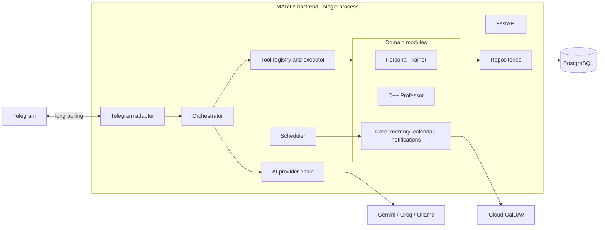
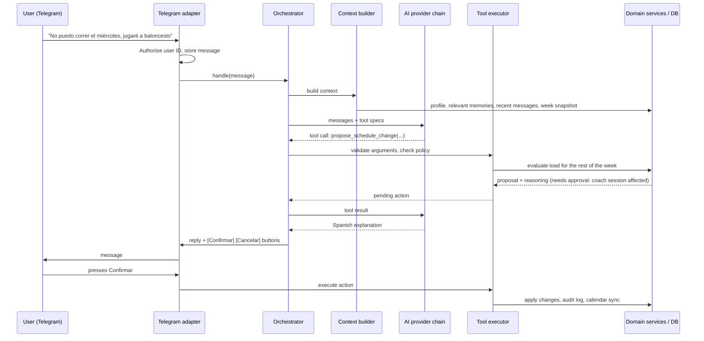

# MARTY Architecture

MARTY is a self-hosted personal assistant. The user talks to it in Spanish through
a private Telegram bot. It keeps persistent memory in PostgreSQL, reads and manages
Apple Calendar events over CalDAV, and hosts specialised modules: the **Personal
Trainer** and the **C++ Professor**. Code and documentation are in English.

This document records the architectural decisions. Related documents:

- [database.md](database.md): schema and data conventions.
- [telegram.md](telegram.md): bot architecture, commands, confirmation flow.
- [ai-providers.md](ai-providers.md): LLM abstraction, fallback and quota handling.
- [security.md](security.md): secrets, authorisation, LLM tool restrictions.
- [deployment.md](deployment.md): installation, operations, backups.
- [implementation-plan.md](implementation-plan.md): phases, milestones, open questions.

## Key decisions

### 1. Modular monolith in a single process

One Python process runs everything on one asyncio event loop:

- **FastAPI** for health checks, and later the authenticated ingestion API for the
  iOS/HealthKit companion.
- **python-telegram-bot** in long-polling mode, started from the FastAPI lifespan.
- **APScheduler** (`AsyncIOScheduler`) for briefings, reports, sync and reminders.

One container, no message broker, no public endpoint. Scheduled jobs send Telegram
messages directly through the same bot instance.

Constraint: exactly **one** process (`uvicorn --workers 1`, one replica). Telegram
rejects concurrent `getUpdates` calls with the same token, and a second scheduler
would duplicate notifications. This is acceptable for a single-user system; if it
ever needs to change, the bot and scheduler can move to a separate container that
uses the same image.

### 2. Specialised agents, not a swarm

The Trainer and the C++ Professor are independent specialists: each has its own
prompt, tools and stored plans. MARTY is still one Telegram bot; a cheap
router picks which specialist handles a message or an attached Word/PDF. They
share memory and the calendar; they do not share training or study logic, and
they do not talk to each other.

Each specialist contributes:

1. **Domain services** with deterministic, testable rules (training load,
   schedule density, study planning, availability, idempotent imports).
2. **Tools** the LLM may call (`log_workout`, `propose_schedule_change`,
   `get_next_study_session`, store a plan, propose calendar events, …),
   each with a Pydantic argument model.
3. **Prompt fragments** describing the domain rules the model must respect.
4. **Ingest** of documents (`.docx`, `.pdf`, pasted text) in addition to
   conversation: keep the original, extract sessions without inventing
   missing fields, then feed the same domain services.

A single orchestrator still runs one tool-calling loop per message, with only
that specialist's tools plus the shared calendar and memory tools. That keeps
the free-tier cost down and avoids an inter-agent protocol. Bulk calendar
writes from an imported document still need a Telegram confirmation button.

### 3. The database is the source of truth; the LLM is the language layer

The model interprets messages and writes replies. Facts come from tool results that
read the database or the calendar. The system prompt forbids stating historical
activity that no tool returned, and statuses such as "completed" only change after a
user report or reliable evidence (Apple Health in the future). A past session with
no report is shown as *unconfirmed*, never as completed or missed.

### 4. Tools with policy tiers instead of free-form actions

The LLM can only call registered tools. It cannot run SQL or shell commands. Every
tool declares a policy:

| Policy | Examples | Behaviour |
| --- | --- | --- |
| `read` | agenda, progress, memories | Runs immediately. |
| `write` | log a workout, log study time, adjust an optional session | Runs immediately, audited, reversible. |
| `confirm` | change a coach-prescribed session, delete data, bulk calendar changes | Stored as a pending action; runs only after the user presses a Telegram button. |

Confirmation happens out of band through Telegram inline buttons, so the model
cannot approve its own proposals, including when manipulated by text in an imported
document or calendar event.

### 5. Deterministic paths do not need the LLM

Slash commands (`/today`, `/week`, `/training`, `/study`, `/progress`, ...) and the
scheduled briefing and weekly report are rendered from data by code. They work
when every AI provider is down or out of quota. The LLM is used for free-form
conversation and, optionally, to add a short comment to generated reports.

### 6. Time handling

- All instants are stored as `timestamptz` in UTC.
- The user's timezone (`Europe/Madrid`) is applied when interpreting input
  ("mañana a las 20:00") and rendering output.
- Recurring weekly templates (work hours, training plan) are stored as local
  wall-clock time (`weekday` + `time`) and materialised into dated instances per
  week, so daylight-saving changes never shift a 20:00 CrossFit session.

### 7. Isolated, replaceable integrations

`app/integrations/` contains adapters for external systems (AI providers, Telegram,
CalDAV, ICS feeds, document import). Services depend on small interfaces, not on
the libraries. CalDAV is a small async client on top of `httpx` (only the
requests MARTY needs, with ETag preconditions); `icalendar` builds and edits
events and `recurring-ical-events` expands repetitions.

### 9. iCloud is the calendar's source of truth

Events are read live from iCloud for the range a question needs, never copied
into the database, so changes made on the iPhone are seen immediately and there
is no sync to go wrong. Only calendar names are cached, for five minutes. Weekly
routines (work, commuting, trainings) are single recurring events; skipping one
day adds an exception instead of deleting the series.

### 8. Privacy by default

The GitHub repository is public. Personal data (schedule, roadmap document, match
calendars, backups, `.env`) never goes into git: it lives in the database, in the
ignored `data/` directory, or in environment variables.

## Components



## Handling a free-form message



The tool loop is capped (for example 4 iterations per message) so a confused model
cannot burn the quota.

## Memory model

| Memory type | Storage |
| --- | --- |
| User profile (stable facts, preferences) | `memories` with `kind = profile`, `user_preferences` |
| Long-term memory (decisions, objectives) | `memories` with `kind = long_term` |
| Conversation history | `conversations`, `messages` |
| Operational state (plans, schedules, progress) | training, learning and calendar tables |
| Activity history | `workout_logs`, `study_logs`, `audit_logs` |

For each message the context builder includes all active profile memories (a small
set), the most relevant long-term memories (PostgreSQL full-text search, ranked with
recency and importance), the recent messages of the current conversation and its
summary, and a compact snapshot of today and the current week. pgvector will be
added only if full-text retrieval proves insufficient.

## Target code layout

Packages are created when a phase needs them. The phase that introduces each part
is noted on the right.

```text
app/
  main.py                    FastAPI app factory, lifespan, wiring         (0-1)
  core/
    config.py                Settings from environment                     (0)
    logging.py               JSON logs with secret redaction               (0)
    assistant.py             Channel-independent entry point, transactions (1)
    orchestrator.py          Tool-calling loop                             (1)
    context.py               Context builder for the LLM                   (1)
    prompts.py               System and summary prompts                    (1)
    agenda.py                Spanish wording of events and agendas         (2)
    summaries.py             Rolling conversation summaries                (1)
    tools.py                 Tool registry, policies, executor             (1)
  api/
    health.py                /health, /health/ready                        (0)
  integrations/
    ai/                      Provider interface, fallback, adapter,
                             factory, list_models                          (0-1)
    telegram/                Bot lifecycle, gatekeeper, handlers, texts    (1)
    apple_calendar/          CalDAV client, iCalendar build/expand         (2)
    ics/                     ICS feed fetching and parsing                 (3)
    documents/               DOCX roadmap parser                           (4)
  services/
    users.py                 Users, preferences, pause/resume              (1)
    conversations.py         Conversation boundaries and messages          (1)
    memory.py                Profile and long-term memory                  (1)
    calendar.py              Calendars, events, free time, conflicts       (2)
    training/                Plans, sessions, load rules                   (3)
    learning/                Roadmap progress, study planner               (4)
    notifications/           Delivery, deduplication, pause/quiet hours    (5)
  agents/
    memory.py                Memory tools (remember, update, forget, list) (1)
    calendar.py              Calendar tools (events, free time, calendars) (2)
    trainer/                 Tools and prompt for the Personal Trainer     (3)
    cpp_professor/           Tools and prompt for the C++ Professor        (4)
  jobs/                      Scheduled jobs (briefing, report, monitors)   (5)
  database/
    base.py                  Declarative base and conventions              (0)
    session.py               Engine and session factory                    (0)
    models/                  ORM models                                    (1+)
    repositories/            Queries per aggregate                         (1+)
    migrations/              Alembic                                       (0+)
tests/
scripts/                     entrypoint, backups, dependency lock
docs/
```

Dependency direction: `integrations/telegram` -> `core` (assistant, orchestrator,
tools) -> `services` -> `database/repositories` and other `integrations`. Tools in
`agents` use `core.tools` and `services`; `main.py` registers them, so `core` does
not import `agents`. The Telegram adapter talks only to `core.assistant.Assistant`.
Only repositories build ORM queries.

## Future extensions

- **Apple Health / Apple Watch**: Apple Health data is only accessible on the
  device through HealthKit, with explicit user permission. There is no server-side
  API. A small iOS companion app would read authorised workouts and push them to a
  new authenticated FastAPI endpoint that writes `workout_logs` with
  `source = apple_health` (deduplicated by the HealthKit UUID). This needs a
  reachable endpoint (VPN such as Tailscale, or a reverse proxy with TLS), the
  HealthKit capability and code signing. Signing limitations will be documented
  in Phase 6.
- **Iron Harder**: no assumption that an API exists. Until a supported method is
  found, workouts are imported from pasted text, documents or screenshots, and the
  original content is always preserved.
- **New agents** (finance, projects, notes): a new module with its own services,
  tools and tables, registered in the orchestrator.
