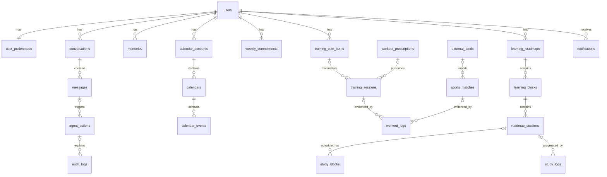

# Database Schema

PostgreSQL 17 is the source of truth for everything MARTY knows. This document is
the **proposed** schema; each phase creates only its own tables through an Alembic
migration, and the design can change during review before then.

## Conventions

- Primary keys: `id BIGINT GENERATED ALWAYS AS IDENTITY`.
- Every top-level entity has `user_id`. There is one user today, but this keeps
  authorisation checks explicit and costs nothing.
- Instants are `timestamptz` (UTC). Dates that belong to the user's calendar
  (`scheduled_date`, `studied_on`) are `date` in `Europe/Madrid`.
- Recurring weekly templates use local wall-clock time: `weekday SMALLINT`
  (ISO, 1 = Monday ... 7 = Sunday) plus `TIME`.
- `created_at` / `updated_at` on mutable rows; `deleted_at` (soft delete) on
  records the user can create, edit or remove. Logs are append-only.
- Enumerations are `VARCHAR` with a `CHECK` constraint (mapped to Python `StrEnum`),
  not native PostgreSQL enums, which are awkward to migrate.
- `JSONB` only for raw external payloads, tool arguments and verbatim document
  structure. Anything that is filtered or aggregated is a real column.
- Constraint and index names follow the naming convention in
  `app/database/base.py`, so migrations are deterministic.
- Derived values (training load = duration × RPE, weekly totals) are computed in
  services, not stored.

## Relationships overview



`calendar_events` links to MARTY entities polymorphically through
`(source_type, source_id)`; that relation is not drawn.

## Phase 1 - Core (created by migration `7c195d4846bb`)

```text
users
  id
  telegram_user_id     BIGINT UNIQUE NOT NULL
  telegram_chat_id     BIGINT NOT NULL
  display_name         TEXT
  timezone             TEXT NOT NULL DEFAULT 'Europe/Madrid'
  locale               TEXT NOT NULL DEFAULT 'es-ES'
  is_active            BOOLEAN NOT NULL DEFAULT true
  created_at, updated_at

user_preferences                         -- 1:1 with users; also holds notification settings
  user_id                    PK, FK users
  notifications_paused       BOOLEAN NOT NULL DEFAULT false
  paused_until               TIMESTAMPTZ NULL      -- /pause with a duration
  quiet_hours_start          TIME NULL
  quiet_hours_end            TIME NULL
  morning_briefing_enabled   BOOLEAN NOT NULL DEFAULT true
  morning_briefing_time      TIME NOT NULL
  weekly_report_enabled      BOOLEAN NOT NULL DEFAULT true
  weekly_report_weekday      SMALLINT NOT NULL DEFAULT 7
  weekly_report_time         TIME NOT NULL
  study_inactivity_days      SMALLINT NOT NULL DEFAULT 3
  updated_at
  -- later phases add columns here (e.g. max daily study minutes) via migrations

conversations
  id, user_id
  channel              VARCHAR NOT NULL DEFAULT 'telegram'
  started_at           TIMESTAMPTZ NOT NULL
  last_message_at      TIMESTAMPTZ NOT NULL
  summary              TEXT NULL             -- rolling summary used as context
  summary_updated_at   TIMESTAMPTZ NULL
  summarized_through_message_id BIGINT NULL  -- last message folded into summary
  -- a new conversation starts after CONVERSATION_IDLE_HOURS (default 6) of silence

messages
  id, conversation_id, user_id
  role                 VARCHAR  -- user | assistant | tool
  content              TEXT
  telegram_message_id  BIGINT NULL
  tool_name            VARCHAR NULL
  tool_call_id         VARCHAR NULL
  llm_provider         VARCHAR NULL
  llm_model            VARCHAR NULL
  input_tokens         INTEGER NULL          -- makes quota consumption visible
  output_tokens        INTEGER NULL
  created_at
  INDEX (conversation_id, id)              -- ordered by id: created_at is the
                                           -- transaction time, shared within a turn

memories                                 -- user profile + long-term memory
  id, user_id
  kind                 VARCHAR  -- profile | long_term
  category             VARCHAR  -- training | study | work | personal | preference | general
  content              TEXT NOT NULL
  source               VARCHAR  -- user_stated | user_confirmed | imported
  importance           SMALLINT NOT NULL DEFAULT 3   -- 1..5
  source_message_id    FK messages NULL
  superseded_by_id     FK memories NULL      -- history instead of overwriting
  search_vector        TSVECTOR GENERATED ALWAYS AS (to_tsvector('spanish', content)) STORED
  created_at, updated_at, deleted_at
  GIN INDEX (search_vector)

agent_actions                            -- every state-changing tool call and pending confirmation
  id, user_id
  message_id           FK messages NULL
  tool_name            VARCHAR NOT NULL
  arguments            JSONB NOT NULL        -- validated arguments
  policy               VARCHAR  -- write | confirm
  status               VARCHAR  -- pending_confirmation | executed | rejected | expired | failed
  explanation          TEXT NULL             -- reasoning shown to the user
  result               JSONB NULL
  error                TEXT NULL
  expires_at           TIMESTAMPTZ NULL      -- pending confirmations expire
  decided_at, executed_at, created_at
  INDEX (user_id, status)

audit_logs                               -- append-only "why did this change?"
  id
  user_id              FK users NULL
  actor                VARCHAR  -- user | marty | scheduler | system
  action               VARCHAR  -- create | update | delete | sync | import
  entity_type          VARCHAR NOT NULL
  entity_id            BIGINT NULL
  changes              JSONB NULL            -- {"field": [old, new]}
  reason               TEXT NULL
  agent_action_id      FK agent_actions NULL
  created_at
  INDEX (entity_type, entity_id)
```

Memory rules: MARTY stores memories the user stated or explicitly confirmed. It
never stores inferred facts without confirmation. Corrections create a new row and
mark the old one as superseded, so history is preserved.

Notes from the implementation:

- `morning_briefing_time` (07:30) and `weekly_report_time` (Sunday 20:00) defaults
  are placeholders until the user chooses (Phase 5).
- `tool` messages store tool results for auditing; only `user` and `assistant`
  messages are sent back to the model as history.
- Integration tests run against a separate `<POSTGRES_DB>_test` database that is
  recreated from the migrations on every test run, and a test checks that the
  models and migrations match.

## Phase 2 - Apple Calendar and availability

```text
calendar_accounts
  id, user_id
  provider             VARCHAR  -- icloud_caldav
  server_url           TEXT NOT NULL
  username             TEXT NOT NULL         -- Apple Account e-mail; the password stays in env
  principal_url        TEXT NULL
  status               VARCHAR  -- active | auth_failed | disabled
  last_success_at      TIMESTAMPTZ NULL
  last_error           TEXT NULL             -- sanitised, never contains credentials
  created_at, updated_at

calendars                                -- also holds per-calendar sync state
  id, account_id
  remote_url           TEXT UNIQUE NOT NULL
  display_name         TEXT
  role                 VARCHAR  -- personal | marty_training | marty_study | marty_reminders | ignored
  is_marty_managed     BOOLEAN NOT NULL      -- MARTY may write only to these
  use_for_availability BOOLEAN NOT NULL DEFAULT true
  sync_token           TEXT NULL
  ctag                 TEXT NULL
  last_synced_at       TIMESTAMPTZ NULL
  created_at, updated_at

calendar_events                          -- cache of external events + link records for MARTY events
  id, calendar_id
  uid                  TEXT NOT NULL         -- iCalendar UID
  recurrence_id        TEXT NULL             -- set for an instance of a recurring event
  href                 TEXT NULL
  etag                 TEXT NULL
  summary              TEXT NULL
  location             TEXT NULL
  starts_at, ends_at   TIMESTAMPTZ NOT NULL
  all_day              BOOLEAN NOT NULL
  status               VARCHAR  -- confirmed | tentative | cancelled
  is_busy              BOOLEAN NOT NULL      -- from TRANSP; transparent events do not block time
  is_marty_managed     BOOLEAN NOT NULL
  source_type          VARCHAR NULL  -- training_session | study_block | sports_match | reminder
  source_id            BIGINT NULL
  content_hash         TEXT NULL             -- hash of what MARTY wrote: idempotent sync, detects user edits
  last_seen_at         TIMESTAMPTZ NOT NULL
  created_at, updated_at, deleted_at
  UNIQUE NULLS NOT DISTINCT (calendar_id, uid, recurrence_id)
  UNIQUE (source_type, source_id) WHERE deleted_at IS NULL   -- one external event per entity
  INDEX (starts_at, ends_at)

weekly_commitments                       -- recurring non-sport blocks used for availability
  id, user_id
  kind                 VARCHAR  -- work | commute | other
  label                TEXT
  weekday              SMALLINT NOT NULL
  start_time, end_time TIME NOT NULL
  valid_from           DATE NOT NULL
  valid_to             DATE NULL
  created_at, updated_at, deleted_at
```

Personal events are cached for a rolling window (for example 7 days back, 5 weeks
ahead) so briefings still work if iCloud is unreachable. Descriptions of personal
events are not stored (data minimisation): availability only needs times, summary
and busy status. MARTY-created events get a deterministic UID derived from the
source entity (for example `training-session-123@marty`), so re-running a sync never
creates duplicates.

## Phase 3 - Personal Trainer

```text
training_plan_items                      -- the weekly template
  id, user_id
  weekday              SMALLINT NOT NULL
  start_time           TIME NULL             -- NULL = flexible within the day
  duration_minutes     SMALLINT NULL
  activity_type        VARCHAR  -- crossfit | basketball_team_training | basketball_shooting
                                --   | running | strength | mobility | other
  title                TEXT NOT NULL
  origin               VARCHAR  -- coach | team | personal | marty_proposed
  commitment           VARCHAR  -- fixed | flexible | optional
  choice_group         VARCHAR NULL          -- alternatives: "running OR shooting" on Wednesday
  planned_intensity    VARCHAR  -- low | moderate | high | very_high
  valid_from           DATE NOT NULL
  valid_to             DATE NULL
  notes                TEXT NULL
  created_at, updated_at, deleted_at

workout_prescriptions                    -- original coach / Iron Harder content, preserved verbatim
  id, user_id
  source               VARCHAR  -- iron_harder_text | iron_harder_image | document | manual
  raw_text             TEXT NULL
  attachment_path      TEXT NULL             -- file in the data volume
  attachment_sha256    TEXT NULL
  parsed               JSONB NULL            -- best-effort structure; never replaces raw_text
  applies_to_date      DATE NULL
  received_at, created_at

training_sessions                        -- concrete, dated planned sessions
  id, user_id
  plan_item_id         FK training_plan_items NULL   -- NULL for ad-hoc sessions
  prescription_id      FK workout_prescriptions NULL
  scheduled_date       DATE NOT NULL
  starts_at, ends_at   TIMESTAMPTZ NULL
  activity_type, title, origin, commitment, planned_intensity
  status               VARCHAR  -- planned | completed | cancelled | substituted
  replaced_by_id       FK training_sessions NULL     -- substitution chain
  created_by           VARCHAR  -- plan | user | marty
  notes                TEXT NULL
  created_at, updated_at, deleted_at
  INDEX (user_id, scheduled_date)

workout_logs                             -- what actually happened (evidence)
  id, user_id
  training_session_id  FK training_sessions NULL   -- NULL for unplanned workouts
  sports_match_id      FK sports_matches NULL
  activity_type        VARCHAR NOT NULL
  performed_on         DATE NOT NULL
  started_at           TIMESTAMPTZ NULL
  duration_minutes     SMALLINT NULL
  rpe                  SMALLINT NULL         -- 1..10 (session RPE)
  fatigue              SMALLINT NULL         -- 1..5 subjective
  notes                TEXT NULL
  source               VARCHAR  -- user_report | apple_health | import
  external_id          TEXT NULL UNIQUE      -- HealthKit workout UUID (Phase 6)
  avg_heart_rate, max_heart_rate   SMALLINT NULL
  distance_m           INTEGER NULL
  active_kcal          INTEGER NULL
  raw_payload          JSONB NULL
  source_message_id    FK messages NULL
  created_at, updated_at, deleted_at
  INDEX (user_id, performed_on)

external_feeds                           -- subscribed ICS feeds (match schedules)
  id, user_id
  kind                 VARCHAR  -- match_schedule
  url                  TEXT NOT NULL         -- may embed a token: never logged
  etag, last_modified  TEXT NULL
  last_fetched_at      TIMESTAMPTZ NULL
  last_status          TEXT NULL
  created_at, updated_at

sports_matches
  id, user_id
  feed_id              FK external_feeds NULL        -- NULL when added manually
  external_uid         TEXT NULL
  competition, opponent, venue   TEXT NULL
  is_home              BOOLEAN NULL
  starts_at            TIMESTAMPTZ NOT NULL
  call_time            TIMESTAMPTZ NULL      -- meeting time before the match
  status               VARCHAR  -- scheduled | played | postponed | cancelled
  result               TEXT NULL
  source_url           TEXT NULL
  created_at, updated_at, deleted_at
  UNIQUE (feed_id, external_uid)
```

A past `planned` session without a report stays `planned`, and is displayed as
unconfirmed. Nothing is marked completed or missed automatically. Changes to
sessions with `origin = coach` always go through a `confirm` tool.

## Phase 4 - C++ Professor

The structure mirrors `Roadmap_CPP_60_Sessions_Expanded_Guide_EN.docx`: 7 blocks,
60 sessions of 60 minutes, each with a five-step timed plan (preparation, theory,
reading, practical work, wrap-up), learning outcomes and review questions. The
document is sequential, so session order is the dependency order and no dependency
table is needed.

```text
learning_roadmaps
  id, user_id
  title                TEXT NOT NULL
  source_filename      TEXT NOT NULL
  source_sha256        TEXT NOT NULL         -- re-importing the same file is a no-op
  status               VARCHAR  -- active | paused | completed | archived
  imported_at, created_at, updated_at
  UNIQUE (user_id, source_sha256)

learning_blocks
  id, roadmap_id
  position             SMALLINT NOT NULL
  title                TEXT NOT NULL         -- e.g. "BLOCK 1 · COMPUTER ARCHITECTURE"
  summary              TEXT NULL
  UNIQUE (roadmap_id, position)

roadmap_sessions
  id, roadmap_id, block_id
  number               SMALLINT NOT NULL     -- 1..60
  title                TEXT NOT NULL
  estimated_minutes    SMALLINT NOT NULL
  outcomes             TEXT NULL             -- "By the end of this session..."
  plan                 JSONB NOT NULL        -- the timed steps, verbatim
  review_questions     TEXT NULL             -- kept for reference, never used to quiz
  status               VARCHAR  -- pending | in_progress | completed | skipped
  started_at, completed_at   TIMESTAMPTZ NULL
  UNIQUE (roadmap_id, number)

study_blocks                             -- planned study time
  id, user_id
  roadmap_session_id   FK roadmap_sessions NULL
  scheduled_date       DATE NOT NULL
  starts_at, ends_at   TIMESTAMPTZ NULL
  planned_minutes      SMALLINT NOT NULL
  status               VARCHAR  -- planned | done | partial | moved | cancelled
  moved_to_id          FK study_blocks NULL
  created_by           VARCHAR  -- planner | user
  created_at, updated_at, deleted_at

study_logs                               -- reported study activity
  id, user_id
  roadmap_session_id   FK roadmap_sessions NULL
  study_block_id       FK study_blocks NULL
  studied_on           DATE NOT NULL
  duration_minutes     SMALLINT NOT NULL
  finished_session     BOOLEAN NOT NULL DEFAULT false
  notes                TEXT NULL
  source               VARCHAR  -- user_report
  source_message_id    FK messages NULL
  created_at, updated_at, deleted_at
  INDEX (user_id, studied_on)
```

## Phase 5 - Notifications

```text
notifications
  id, user_id
  kind                 VARCHAR  -- morning_briefing | weekly_report | study_inactivity
                                --   | conflict | confirmation_request
  dedupe_key           TEXT NOT NULL
  scheduled_for        TIMESTAMPTZ NOT NULL
  status               VARCHAR  -- pending | sent | failed | suppressed
  content              TEXT NULL
  telegram_message_id  BIGINT NULL
  sent_at              TIMESTAMPTZ NULL
  error                TEXT NULL
  created_at
  UNIQUE (user_id, dedupe_key)
```

The unique `dedupe_key` is what prevents repeated reminders. Examples:
`morning_briefing:2026-11-03`, `study_inactivity:since:2026-10-30` (one reminder
per inactivity streak), `conflict:<hash of the overlapping event IDs>`.

## Not planned as separate tables

- `training_metrics`: the metrics HealthKit can provide fit as nullable columns on
  `workout_logs`; a separate table only if per-sample data (heart-rate series) is
  ever needed.
- `training_adjustments`: a schedule change is an `agent_actions` row (proposal,
  explanation, approval) plus `audit_logs` rows for each modified session.
- `calendar_sync_state` and `notification_preferences`: merged into `calendars` and
  `user_preferences`.
